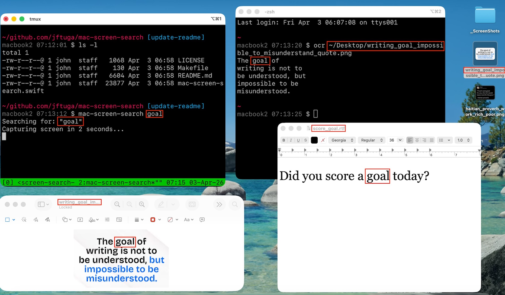
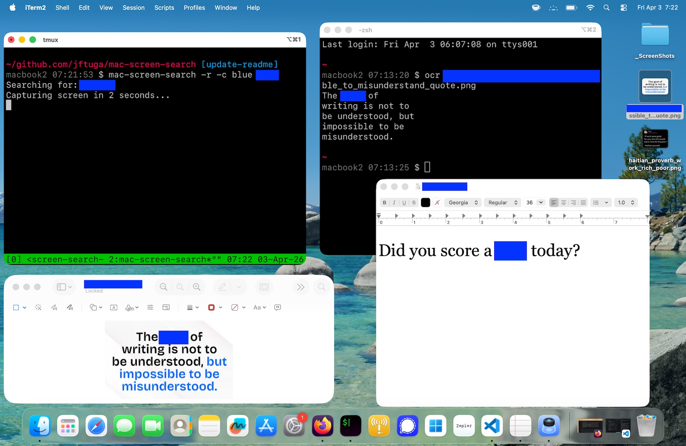
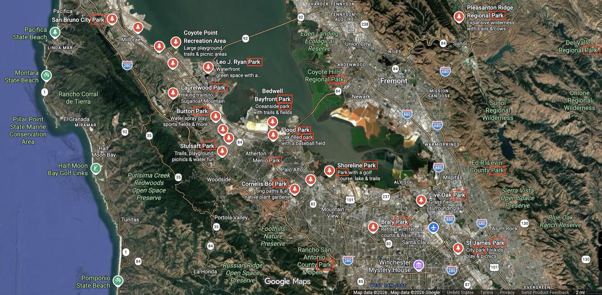
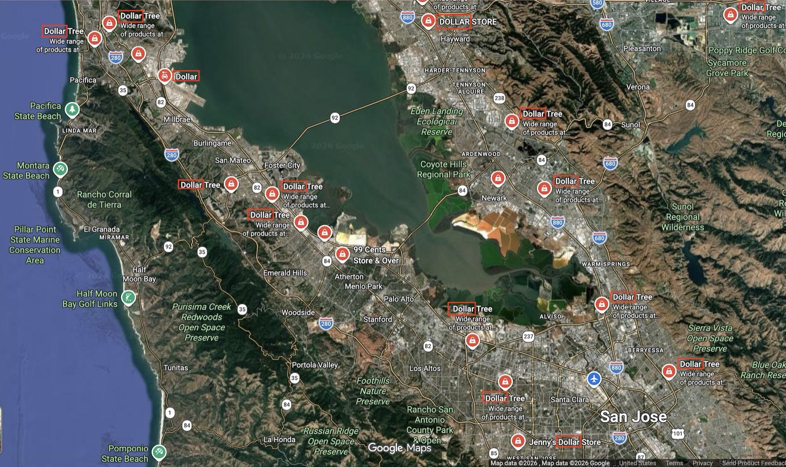

# mac-screen-search

[Intro](#intro) | [Screenshots](#screenshots) | [Installation](#installation) | [Quick start](#quick-start) | [Documentation](#documentation) | [Disclosure](#personal-project-disclosure)

## Intro

A macOS command-line tool that finds text on screen using OCR and opens an annotated screenshot in Preview. It can also redact or blur matches in screenshots and batches of existing images.

AI disclaimer: Built with Claude Opus 4.6; use at your own risk and verify redactions before sharing sensitive screenshots ([full disclaimer](docs/disclaimer.md)).

## Screenshots

|  |  |
|:---:|:---:|
| screenshot mode | redact mode |
|  |  |
| park | dollar |

## Installation

Requires macOS and Screen Recording permission for screen capture.

```sh
brew tap jftuga/tap
brew install jftuga/tap/mac-screen-search
```

See [installation](docs/installation.md) for upgrades, binary downloads, and building from source.

## Quick start

```sh
mac-screen-search "password"                  # outline matches and open in Preview
mac-screen-search -r -c black "secret"        # redact matches
mac-screen-search "password|secret|api-key"   # search multiple terms
```

Screen capture starts after a 2-second delay; use `-t 0` for immediate capture. Run `mac-screen-search -h` for help, or see the [options and examples](docs/usage.md).

## Documentation

- [Installation and building](docs/installation.md)
- [Usage, options, and examples](docs/usage.md)
- [How it works](docs/how-it-works.md)
- [AI disclaimer](docs/disclaimer.md)

## Personal Project Disclosure

This program is my own original idea, conceived and developed entirely:

* On my own personal time, outside of work hours
* For my own personal benefit and use
* On my personally owned equipment
* Without using any employer resources, proprietary information, or trade secrets
* Without any connection to my employer's business, products, or services
* Independent of any duties or responsibilities of my employment

This project does not relate to my employer's actual or demonstrably
anticipated research, development, or business activities. No
confidential or proprietary information from any employer was used
in its creation.
